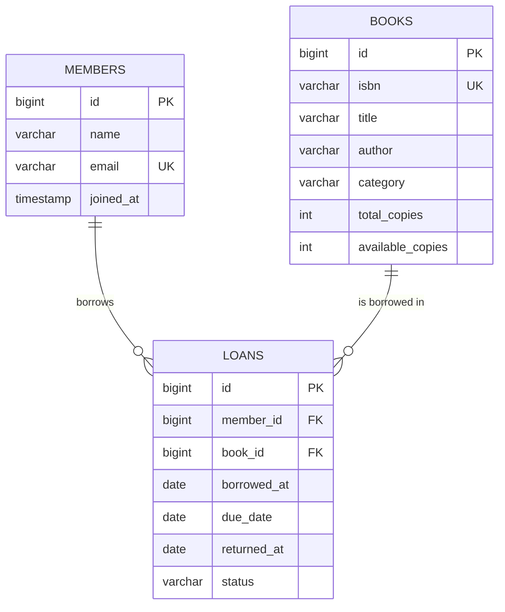
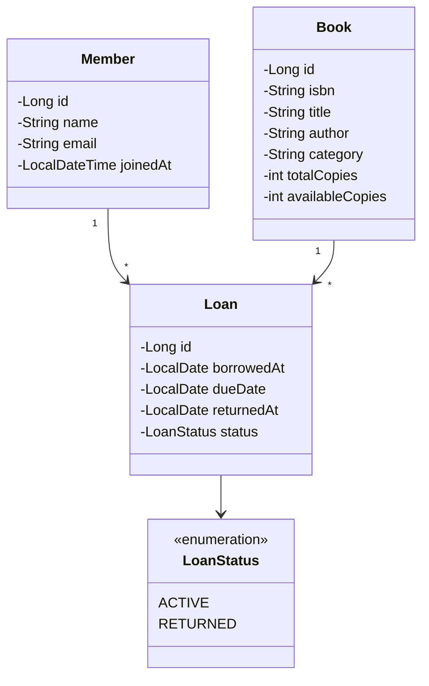
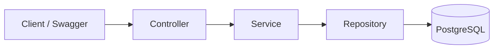

# BookNest Lite: Lean Spring Boot Project Plan (2 Weeks)

> A simplified Library Management backend. 3 tables, no security, no Redis. The goal is to **understand the core of Spring Boot deeply** by coding it by hand. Advanced features are added later as separate upgrades.

**Time:** ~14 days at 1.5-2 hrs/day (20-25 hours)
**Stack:** Java 21 · Spring Boot 3.5.x · Spring Data JPA · PostgreSQL · Lombok · springdoc (Swagger)

---

## 1. Scope

### Features
1. CRUD for **books**
2. CRUD for **members**
3. **Borrow** a book (rules: copies available, member max 3 active loans, no duplicate active loan)
4. **Return** a book
5. **Search** books by title with pagination and sorting
6. Consistent **error responses**
7. **Swagger UI** to test everything

### Deliberately left out (add later)
Spring Security/JWT, Flyway, Redis, events, scheduler, fines, reservations, MapStruct, Testcontainers.

### Concepts you will learn
IoC/DI · layered architecture · DTOs · Bean Validation · JPA entities and `@ManyToOne` · derived queries and `@Query` · pagination · `@Transactional` · global exception handling · profiles · unit testing with Mockito

---

## 2. ER Diagram



---

## 3. UML Class Diagram



### Layers



---

## 4. Setup

### 4.1 Run PostgreSQL with Docker (one command)
```bash
docker run --name booknest-db -e POSTGRES_DB=booknest -e POSTGRES_USER=booknest \
  -e POSTGRES_PASSWORD=booknest -p 5432:5432 -d postgres:16
```
*(No Docker? Swap the PostgreSQL dependency for H2 and skip this step.)*

### 4.2 `pom.xml`
```xml
<?xml version="1.0" encoding="UTF-8"?>
<project xmlns="http://maven.apache.org/POM/4.0.0"
         xmlns:xsi="http://www.w3.org/2001/XMLSchema-instance"
         xsi:schemaLocation="http://maven.apache.org/POM/4.0.0 https://maven.apache.org/xsd/maven-4.0.0.xsd">
    <modelVersion>4.0.0</modelVersion>

    <parent>
        <groupId>org.springframework.boot</groupId>
        <artifactId>spring-boot-starter-parent</artifactId>
        <version>3.5.6</version>
        <relativePath/>
    </parent>

    <groupId>com.booknest</groupId>
    <artifactId>booknest-lite</artifactId>
    <version>0.0.1-SNAPSHOT</version>

    <properties>
        <java.version>21</java.version>
        <springdoc.version>2.8.13</springdoc.version>
    </properties>

    <dependencies>
        <dependency>
            <groupId>org.springframework.boot</groupId>
            <artifactId>spring-boot-starter-web</artifactId>
        </dependency>
        <dependency>
            <groupId>org.springframework.boot</groupId>
            <artifactId>spring-boot-starter-validation</artifactId>
        </dependency>
        <dependency>
            <groupId>org.springframework.boot</groupId>
            <artifactId>spring-boot-starter-data-jpa</artifactId>
        </dependency>
        <dependency>
            <groupId>org.postgresql</groupId>
            <artifactId>postgresql</artifactId>
            <scope>runtime</scope>
        </dependency>
        <dependency>
            <groupId>org.springdoc</groupId>
            <artifactId>springdoc-openapi-starter-webmvc-ui</artifactId>
            <version>${springdoc.version}</version>
        </dependency>
        <dependency>
            <groupId>org.projectlombok</groupId>
            <artifactId>lombok</artifactId>
            <optional>true</optional>
        </dependency>
        <dependency>
            <groupId>org.springframework.boot</groupId>
            <artifactId>spring-boot-starter-test</artifactId>
            <scope>test</scope>
        </dependency>
    </dependencies>

    <build>
        <plugins>
            <plugin>
                <groupId>org.springframework.boot</groupId>
                <artifactId>spring-boot-maven-plugin</artifactId>
                <configuration>
                    <excludes>
                        <exclude>
                            <groupId>org.projectlombok</groupId>
                            <artifactId>lombok</artifactId>
                        </exclude>
                    </excludes>
                </configuration>
            </plugin>
        </plugins>
    </build>
</project>
```

### 4.3 `application.yml`
```yaml
spring:
  application:
    name: booknest-lite
  datasource:
    url: jdbc:postgresql://localhost:5432/booknest
    username: booknest
    password: booknest
  jpa:
    hibernate:
      ddl-auto: update        # fine for learning; switch to Flyway later
    show-sql: true            # watch the SQL Hibernate generates
    properties:
      hibernate.format_sql: true
    open-in-view: false

app:
  library:
    loan-days: 14
    max-active-loans: 3
```

### 4.4 Package structure
```
com.booknest
├── BookNestLiteApplication.java
├── controller/     BookController, MemberController, LoanController
├── service/        BookService, MemberService, LoanService
├── repository/     BookRepository, MemberRepository, LoanRepository
├── entity/         Book, Member, Loan, LoanStatus
├── dto/            request and response records
├── exception/      ResourceNotFoundException, BusinessRuleException, GlobalExceptionHandler
└── config/         LibraryProperties
```

---

## 5. API Design

| Method | Endpoint | Description |
|---|---|---|
| POST | `/api/books` | Create book |
| GET | `/api/books?title=&page=0&size=10&sort=title,asc` | Search + paginate |
| GET | `/api/books/{id}` | Get one book |
| PUT | `/api/books/{id}` | Update book |
| DELETE | `/api/books/{id}` | Delete book |
| POST | `/api/members` | Create member |
| GET | `/api/members` | List members |
| GET | `/api/members/{id}` | Get one member |
| PUT | `/api/members/{id}` | Update member |
| DELETE | `/api/members/{id}` | Delete member |
| POST | `/api/loans` | Borrow `{ "memberId": 1, "bookId": 2 }` |
| POST | `/api/loans/{id}/return` | Return book |
| GET | `/api/members/{id}/loans` | A member's loans |

### Standard error format
```json
{
  "timestamp": "2026-10-21T10:15:30Z",
  "status": 404,
  "message": "Book with id 7 not found",
  "path": "/api/books/7"
}
```

---

## 6. Business Rules (for borrow / return)

**Borrow**
1. Member must exist, book must exist (else 404)
2. Book `availableCopies` must be greater than 0
3. Member must have fewer than 3 `ACTIVE` loans
4. Member must not already have an `ACTIVE` loan for the same book
5. Decrease `availableCopies`, create the loan with `dueDate = today + 14 days`, status `ACTIVE`
6. All of this runs in **one `@Transactional` method**

**Return**
1. Loan must exist and be `ACTIVE` (else error)
2. Set `returnedAt = today`, status `RETURNED`
3. Increase the book's `availableCopies`

---

## 7. Day-by-Day Plan

> Rule: finish each day's checklist before moving on. Test everything in Swagger or Postman. Commit to Git at the end of every day.

### Week 1: Foundations

#### Day 1: Setup and first run
- Generate the project at start.spring.io (or paste the `pom.xml` above) and open it in IntelliJ
- Start PostgreSQL, configure `application.yml`
- Create the `Book` entity only (`@Entity`, `@Id`, `@GeneratedValue`, `@Column`)
- Run the app and confirm the `books` table is created
- [ ] App starts without errors
- [ ] You can see the `CREATE TABLE` SQL in the console
- **Learn:** what `@SpringBootApplication` does, what auto-configuration means

#### Day 2: Entities and relationships
- Create `Member`, `Loan` and `LoanStatus`
- Map `Loan` to `Member` and `Book` with `@ManyToOne(fetch = LAZY)`
- Check the foreign keys in the database (pgAdmin, DBeaver or `psql`)
- [ ] 3 tables created with correct foreign keys
- **Learn:** owning side, `@JoinColumn`, why LAZY, enum as string (`@Enumerated(EnumType.STRING)`)

#### Day 3: Book repository and first endpoints
- Create `BookRepository extends JpaRepository<Book, Long>`
- Create `BookController` with `POST /api/books` and `GET /api/books/{id}` (return the entity for now)
- Test in Swagger
- [ ] Insert a book and fetch it back
- **Learn:** DI, `@RestController`, `@RequestBody`, `@PathVariable`, `ResponseEntity`

#### Day 4: Service layer and DTOs
- Add `BookService`; move logic out of the controller
- Create `BookRequest` and `BookResponse` records; write the conversion by hand
- Controller now talks only to the service and only uses DTOs
- [ ] No entity is returned from a controller anymore
- **Learn:** Controller → Service → Repository, why DTOs

#### Day 5: Validation and full Book CRUD
- Add `@Valid`, `@NotBlank`, `@Min`, `@Size` to `BookRequest`
- Finish `PUT` and `DELETE`
- [ ] Invalid input returns 400 (the format will be improved tomorrow)
- **Learn:** Bean Validation, difference between 200, 201, 204, 400

#### Day 6: Exception handling
- Create `ResourceNotFoundException` and `BusinessRuleException`
- Write `GlobalExceptionHandler` with `@RestControllerAdvice` and the `ApiError` record
- Handle `MethodArgumentNotValidException` for validation errors
- [ ] Missing book returns the standard 404 JSON
- [ ] Validation error lists the failing fields
- **Learn:** `@ExceptionHandler`, centralized error handling

#### Day 7: Member CRUD and catch-up day
- Repeat the full pattern for `Member` (entity exists; add repository, service, DTOs, controller)
- Email uniqueness check; return 409 on duplicate
- Use any spare time to clean up and re-read your Week 1 code
- [ ] Member CRUD works end to end
- **Learn:** repeating the pattern without help is how it sticks

### Week 2: Business logic and polish

#### Day 8: Search and pagination
- Add `Page<Book> findByTitleContainingIgnoreCase(String title, Pageable pageable)`
- Controller accepts `title`, `page`, `size`, `sort`
- [ ] Search with 15+ books across multiple pages
- **Learn:** derived queries, `Pageable`, `Page<T>`; try a `@Query` version too

#### Day 9: Loan repository and queries
- Add to `LoanRepository`:
  - `long countByMemberIdAndStatus(Long memberId, LoanStatus status)`
  - `boolean existsByMemberIdAndBookIdAndStatus(...)`
  - `List<Loan> findByMemberId(Long memberId)`
- Write `LibraryProperties` with `@ConfigurationProperties` for loan days and max loans
- **Learn:** query derivation naming, type-safe config

#### Day 10: Borrow logic
- Write `LoanService.borrow(...)` following the rules in section 6
- Annotate it with `@Transactional`
- Create `LoanController` with `POST /api/loans`
- [ ] Successful borrow decreases copies
- [ ] Each rule violation returns a clear error
- **Learn:** `@Transactional`, what a transaction rollback does (throw an exception after decrementing and see the change roll back)

#### Day 11: Return logic and member loan history
- Write `LoanService.returnBook(...)`
- Add `GET /api/members/{id}/loans` returning a `LoanResponse` DTO list
- Watch the SQL logs; notice if lazy loading triggers extra queries
- [ ] Borrow, return and re-borrow cycle works
- **Learn:** the N+1 problem, introduce `@EntityGraph` or `JOIN FETCH` to fix it

#### Day 12: Swagger and profiles
- Add springdoc annotations (`@Operation`, `@Tag`) to the controllers
- Create `application-dev.yml` and `application-prod.yml`; run with each profile
- [ ] Swagger UI at `/swagger-ui.html` documents every endpoint
- **Learn:** profiles, externalized config

#### Day 13: Unit tests
- Test `LoanService` with JUnit 5 and Mockito (mock the repositories)
- Cases: borrow succeeds, no copies left, loan limit reached, duplicate loan, return already-returned loan
- Optional: one `@WebMvcTest` for `BookController`
- [ ] At least 6 passing tests
- **Learn:** `@ExtendWith(MockitoExtension.class)`, `@Mock`, `@InjectMocks`, `verify`

#### Day 14: README and wrap-up
- Write a README: what it does, how to run it, API table, ER diagram, what you learned
- Push to GitHub with a clean commit history
- Rebuild one feature (e.g. Member CRUD) from scratch without looking, to check your understanding
- [ ] Anyone can clone the repo and run it using your README
- [ ] You can explain every layer and every annotation you used

---

## 8. Starter Code Skeleton (to get unstuck, not to copy)

### Entity shape
```java
@Entity
@Table(name = "books")
@Getter @Setter @NoArgsConstructor
public class Book {
    @Id @GeneratedValue(strategy = GenerationType.IDENTITY)
    private Long id;

    @Column(nullable = false, unique = true)
    private String isbn;

    @Column(nullable = false)
    private String title;

    private String author;
    private String category;
    private int totalCopies;
    private int availableCopies;
}
```

### Borrow method outline (write the body yourself)
```java
@Transactional
public LoanResponse borrow(BorrowRequest req) {
    // 1. find member (or throw ResourceNotFoundException)
    // 2. find book   (or throw ResourceNotFoundException)
    // 3. if book.getAvailableCopies() <= 0 -> throw BusinessRuleException
    // 4. if activeLoanCount >= props.maxActiveLoans() -> throw BusinessRuleException
    // 5. if member already has this book ACTIVE -> throw BusinessRuleException
    // 6. book.setAvailableCopies(book.getAvailableCopies() - 1)
    // 7. build Loan (dates, status ACTIVE), save it
    // 8. return mapped LoanResponse
}
```

---

## 9. Debugging Tips for Beginners

- **Read the stack trace from the bottom**, looking for "Caused by:". The real error is there.
- **App won't start?** Usually a database connection issue, a missing `@Entity` field mapping, or a bean that can't be found.
- **`LazyInitializationException`?** You touched a lazy relationship outside a transaction. Fetch what you need in the service or map to a DTO inside the transaction.
- **404 on your endpoint?** Check the `@RequestMapping` path and the package of your main class (component scan only covers its package and below).
- **Turn on SQL logging** (already in the config) and read what Hibernate generates.
- Set a **breakpoint** in your controller and step through a request once. It teaches the flow better than any article.

---

## 10. After Lite: Upgrade Path

Add these one at a time, each as its own Git branch/commit. Each is a topic you can learn independently.

| Order | Upgrade | New concepts |
|---|---|---|
| 1 | Split `author` and `category` into their own tables | Many-to-many, join tables |
| 2 | Flyway migrations (`ddl-auto=validate`) | Versioned schema |
| 3 | Spring Security + JWT, roles | Filter chain, authentication |
| 4 | Fines + scheduled overdue job | `@Scheduled`, more business rules |
| 5 | Redis caching for book reads | `@Cacheable`, `@CacheEvict` |
| 6 | Events + reservations | `@TransactionalEventListener`, `@Async` |
| 7 | Integration tests with Testcontainers | Real DB in tests |
| 8 | Dockerfile + docker-compose, deploy | Containerization |

The full **BookNest** guide you already have is your reference for steps 1 to 8.

---

## 11. Weekly Tracker

| Day | Goal | Done |
|---|---|---|
| 1 | Setup, Book entity, first run | ☐ |
| 2 | Member, Loan, relationships | ☐ |
| 3 | Book repository and endpoints | ☐ |
| 4 | Service layer and DTOs | ☐ |
| 5 | Validation and full Book CRUD | ☐ |
| 6 | Global exception handler | ☐ |
| 7 | Member CRUD, catch-up | ☐ |
| 8 | Search and pagination | ☐ |
| 9 | Loan repository, config properties | ☐ |
| 10 | Borrow logic with `@Transactional` | ☐ |
| 11 | Return logic, loan history, N+1 | ☐ |
| 12 | Swagger and profiles | ☐ |
| 13 | Unit tests | ☐ |
| 14 | README and push to GitHub | ☐ |
