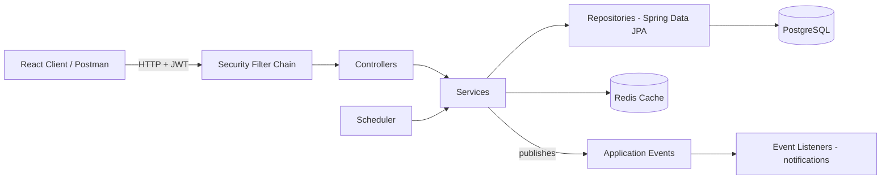
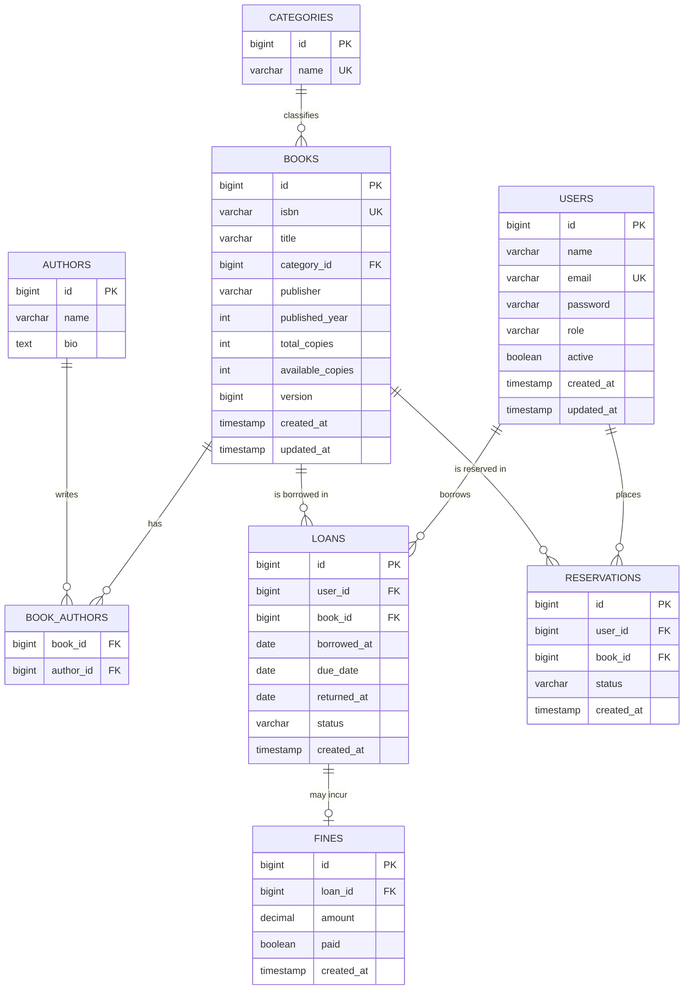
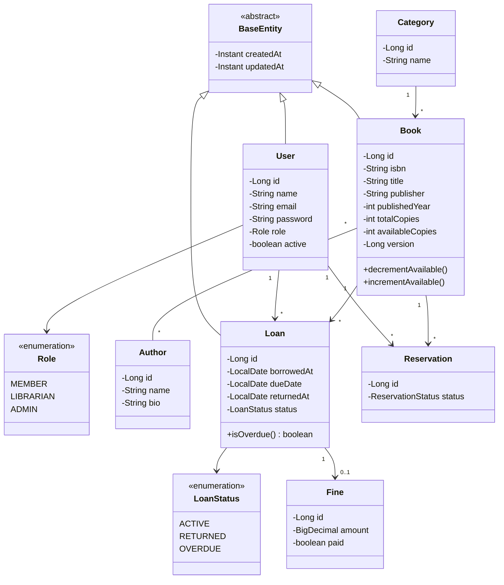
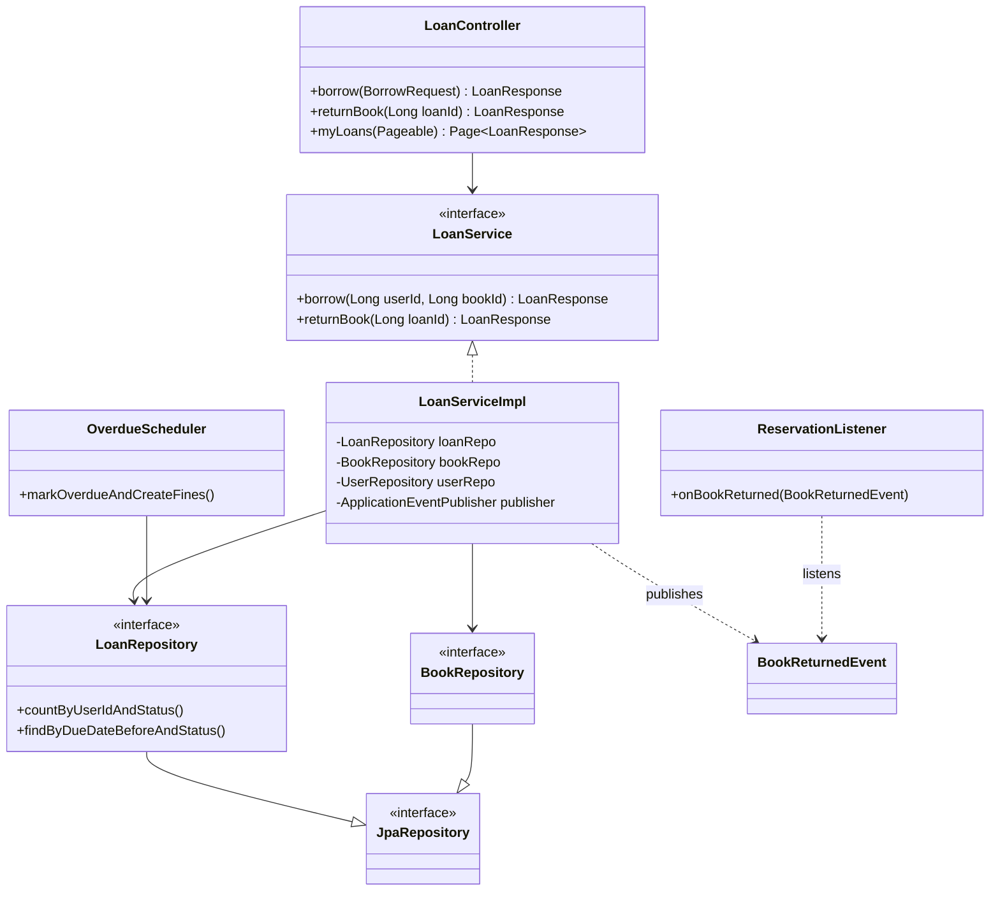
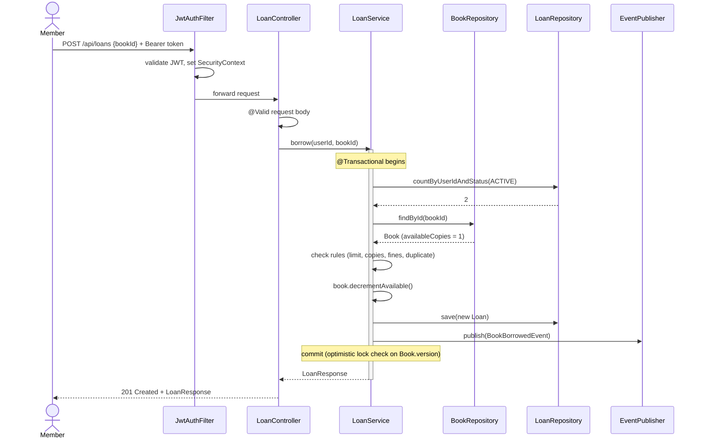
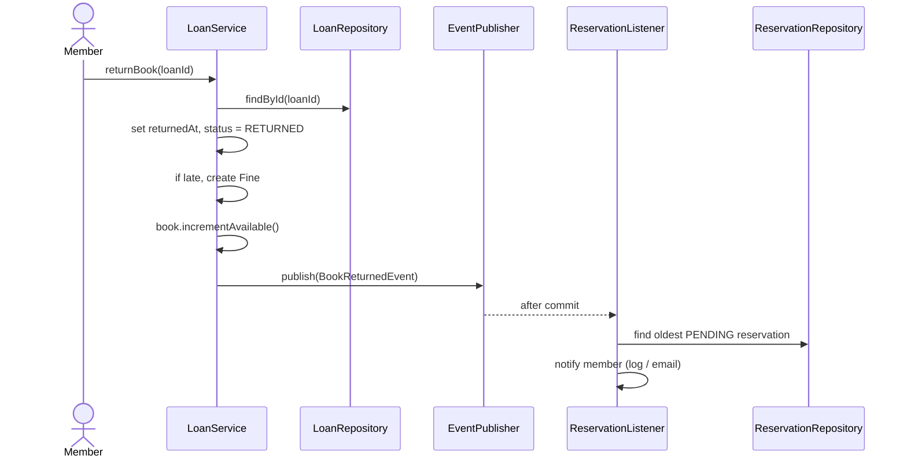

# BookNest: Library Management System (Full Spring Boot Project)

> A complete, interview-ready backend project. It covers every important Spring Boot concept in one codebase, with ER diagram, UML diagrams, key code, and a build order.
> Diagrams use **Mermaid** (renders in GitHub, VS Code with a Mermaid extension, Obsidian, and most markdown viewers).

**Stack:** Java 21 · Spring Boot 3.x · Spring Data JPA · PostgreSQL · Spring Security + JWT · Redis · Flyway · Docker · JUnit 5 + Mockito + Testcontainers

---

## 1. Project Overview

**BookNest** lets a library manage books, members, loans, reservations and fines.

### Roles
| Role | Can do |
|---|---|
| `MEMBER` | Browse/search books, borrow, return, reserve, view own loans and fines |
| `LIBRARIAN` | Everything a member can + add/update books, authors, categories, view all loans |
| `ADMIN` | Everything + manage users and roles, view reports |

### Business Rules
1. A member can have at most **3 active loans**.
2. A book can be borrowed only if `availableCopies > 0`.
3. Loan period is **14 days**.
4. Overdue fine is **Rs. 5 per day**; members with unpaid fines above Rs. 100 cannot borrow.
5. If a book has no copies, a member can **reserve** it; when a copy is returned, the first reservation is notified.
6. A member cannot borrow the same book twice at the same time.

---

## 2. Architecture



**Layers:** Controller (HTTP) → Service (business logic and transactions) → Repository (data access). DTOs cross the controller boundary; entities never leave the service layer.

---

## 3. ER Diagram



### Relationship summary
| Relationship | Type | Implementation |
|---|---|---|
| Category → Book | One-to-Many | `@ManyToOne` on `Book`, FK `category_id` |
| Book ↔ Author | Many-to-Many | `@ManyToMany` with join table `book_authors` |
| User → Loan | One-to-Many | `@ManyToOne` on `Loan` |
| Book → Loan | One-to-Many | `@ManyToOne` on `Loan` |
| Loan → Fine | One-to-One | `@OneToOne` on `Fine` (owning side) |
| User/Book → Reservation | One-to-Many | `@ManyToOne` on `Reservation` |

---

## 4. UML Class Diagram



### Service-layer class diagram



---

## 5. UML Sequence Diagram: Borrow a Book



### Sequence: Return a Book and Notify Reservation



---

## 6. Project Structure

```
booknest/
├── pom.xml
├── docker-compose.yml
├── Dockerfile
└── src/
    ├── main/
    │   ├── java/com/booknest/
    │   │   ├── BookNestApplication.java
    │   │   ├── config/            # SecurityConfig, CacheConfig, OpenApiConfig, JpaAuditingConfig
    │   │   ├── security/          # JwtService, JwtAuthFilter, CustomUserDetailsService
    │   │   ├── controller/        # AuthController, BookController, LoanController ...
    │   │   ├── service/           # interfaces
    │   │   │   └── impl/
    │   │   ├── repository/
    │   │   ├── entity/            # BaseEntity, User, Book, Loan ...
    │   │   ├── dto/               # request/response records
    │   │   ├── mapper/            # entity <-> DTO (MapStruct or manual)
    │   │   ├── exception/         # custom exceptions + GlobalExceptionHandler
    │   │   ├── event/             # events + listeners
    │   │   └── scheduler/         # OverdueScheduler
    │   └── resources/
    │       ├── application.yml
    │       ├── application-dev.yml
    │       ├── application-prod.yml
    │       └── db/migration/      # V1__init.sql, V2__seed.sql
    └── test/java/com/booknest/    # unit + slice + integration tests
```

---

## 7. Setup

### `pom.xml` dependencies (starters)
- `spring-boot-starter-web`
- `spring-boot-starter-data-jpa`
- `spring-boot-starter-validation`
- `spring-boot-starter-security`
- `spring-boot-starter-data-redis`
- `spring-boot-starter-cache`
- `spring-boot-starter-actuator`
- `postgresql` (runtime), `flyway-core`, `flyway-database-postgresql`
- `jjwt-api`, `jjwt-impl`, `jjwt-jackson`
- `springdoc-openapi-starter-webmvc-ui`
- `lombok` (optional), `mapstruct` (optional)
- Test: `spring-boot-starter-test`, `spring-security-test`, `testcontainers` (`postgresql`, `junit-jupiter`)

### `docker-compose.yml`
```yaml
services:
  postgres:
    image: postgres:16
    environment:
      POSTGRES_DB: booknest
      POSTGRES_USER: booknest
      POSTGRES_PASSWORD: booknest
    ports: ["5432:5432"]
    volumes: [pgdata:/var/lib/postgresql/data]

  redis:
    image: redis:7
    ports: ["6379:6379"]

volumes:
  pgdata:
```

### `application.yml`
```yaml
spring:
  application:
    name: booknest
  profiles:
    active: dev
  datasource:
    url: jdbc:postgresql://localhost:5432/booknest
    username: booknest
    password: booknest
  jpa:
    hibernate:
      ddl-auto: validate        # Flyway owns the schema
    open-in-view: false         # avoid lazy loading in controllers
    properties:
      hibernate.format_sql: true
  data:
    redis:
      host: localhost
      port: 6379
  cache:
    type: redis

app:
  jwt:
    secret: ${JWT_SECRET:change-me-to-a-long-random-string-at-least-32-bytes}
    expiration-minutes: 60
  library:
    loan-days: 14
    max-active-loans: 3
    fine-per-day: 5
    max-unpaid-fine: 100

management:
  endpoints:
    web:
      exposure:
        include: health,info,metrics
```

---

## 8. Database Migration (Flyway): `V1__init.sql`

```sql
CREATE TABLE users (
    id BIGSERIAL PRIMARY KEY,
    name VARCHAR(100) NOT NULL,
    email VARCHAR(150) NOT NULL UNIQUE,
    password VARCHAR(255) NOT NULL,
    role VARCHAR(20) NOT NULL,
    active BOOLEAN NOT NULL DEFAULT TRUE,
    created_at TIMESTAMP NOT NULL DEFAULT now(),
    updated_at TIMESTAMP NOT NULL DEFAULT now()
);

CREATE TABLE categories (
    id BIGSERIAL PRIMARY KEY,
    name VARCHAR(100) NOT NULL UNIQUE
);

CREATE TABLE authors (
    id BIGSERIAL PRIMARY KEY,
    name VARCHAR(150) NOT NULL,
    bio TEXT
);

CREATE TABLE books (
    id BIGSERIAL PRIMARY KEY,
    isbn VARCHAR(20) NOT NULL UNIQUE,
    title VARCHAR(255) NOT NULL,
    category_id BIGINT REFERENCES categories(id),
    publisher VARCHAR(150),
    published_year INT,
    total_copies INT NOT NULL CHECK (total_copies >= 0),
    available_copies INT NOT NULL CHECK (available_copies >= 0),
    version BIGINT NOT NULL DEFAULT 0,
    created_at TIMESTAMP NOT NULL DEFAULT now(),
    updated_at TIMESTAMP NOT NULL DEFAULT now()
);

CREATE TABLE book_authors (
    book_id BIGINT NOT NULL REFERENCES books(id) ON DELETE CASCADE,
    author_id BIGINT NOT NULL REFERENCES authors(id) ON DELETE CASCADE,
    PRIMARY KEY (book_id, author_id)
);

CREATE TABLE loans (
    id BIGSERIAL PRIMARY KEY,
    user_id BIGINT NOT NULL REFERENCES users(id),
    book_id BIGINT NOT NULL REFERENCES books(id),
    borrowed_at DATE NOT NULL,
    due_date DATE NOT NULL,
    returned_at DATE,
    status VARCHAR(20) NOT NULL,
    created_at TIMESTAMP NOT NULL DEFAULT now(),
    updated_at TIMESTAMP NOT NULL DEFAULT now()
);
CREATE INDEX idx_loans_user_status ON loans(user_id, status);
CREATE INDEX idx_loans_due_status ON loans(due_date, status);

CREATE TABLE fines (
    id BIGSERIAL PRIMARY KEY,
    loan_id BIGINT NOT NULL UNIQUE REFERENCES loans(id),
    amount NUMERIC(10,2) NOT NULL,
    paid BOOLEAN NOT NULL DEFAULT FALSE,
    created_at TIMESTAMP NOT NULL DEFAULT now()
);

CREATE TABLE reservations (
    id BIGSERIAL PRIMARY KEY,
    user_id BIGINT NOT NULL REFERENCES users(id),
    book_id BIGINT NOT NULL REFERENCES books(id),
    status VARCHAR(20) NOT NULL,
    created_at TIMESTAMP NOT NULL DEFAULT now()
);
CREATE INDEX idx_reservations_book_status ON reservations(book_id, status, created_at);
```

---

## 9. Key Code

### 9.1 Auditing base entity
```java
@MappedSuperclass
@EntityListeners(AuditingEntityListener.class)
@Getter @Setter
public abstract class BaseEntity {

    @CreatedDate
    @Column(updatable = false)
    private Instant createdAt;

    @LastModifiedDate
    private Instant updatedAt;
}

@Configuration
@EnableJpaAuditing
public class JpaAuditingConfig {}
```

### 9.2 Entities
```java
@Entity
@Table(name = "books")
@Getter @Setter @NoArgsConstructor
public class Book extends BaseEntity {

    @Id @GeneratedValue(strategy = GenerationType.IDENTITY)
    private Long id;

    @Column(nullable = false, unique = true)
    private String isbn;

    @Column(nullable = false)
    private String title;

    @ManyToOne(fetch = FetchType.LAZY)
    @JoinColumn(name = "category_id")
    private Category category;

    @ManyToMany
    @JoinTable(name = "book_authors",
        joinColumns = @JoinColumn(name = "book_id"),
        inverseJoinColumns = @JoinColumn(name = "author_id"))
    private Set<Author> authors = new HashSet<>();

    private String publisher;
    private Integer publishedYear;
    private int totalCopies;
    private int availableCopies;

    @Version                       // optimistic locking
    private Long version;

    public void decrementAvailable() {
        if (availableCopies <= 0) throw new BookNotAvailableException(id);
        availableCopies--;
    }

    public void incrementAvailable() {
        if (availableCopies >= totalCopies) throw new IllegalStateException("Copies exceed total");
        availableCopies++;
    }
}
```

```java
@Entity
@Table(name = "loans")
@Getter @Setter @NoArgsConstructor
public class Loan extends BaseEntity {

    @Id @GeneratedValue(strategy = GenerationType.IDENTITY)
    private Long id;

    @ManyToOne(fetch = FetchType.LAZY, optional = false)
    private User user;

    @ManyToOne(fetch = FetchType.LAZY, optional = false)
    private Book book;

    private LocalDate borrowedAt;
    private LocalDate dueDate;
    private LocalDate returnedAt;

    @Enumerated(EnumType.STRING)
    private LoanStatus status;

    @OneToOne(mappedBy = "loan", cascade = CascadeType.ALL)
    private Fine fine;

    public boolean isOverdue() {
        return status == LoanStatus.ACTIVE && LocalDate.now().isAfter(dueDate);
    }
}
```

### 9.3 Repositories
```java
public interface BookRepository extends JpaRepository<Book, Long> {

    Optional<Book> findByIsbn(String isbn);

    // avoids N+1 when listing books with category and authors
    @EntityGraph(attributePaths = {"category", "authors"})
    Page<Book> findByTitleContainingIgnoreCase(String title, Pageable pageable);

    @Query("""
        select b from Book b
        join b.authors a
        where lower(a.name) like lower(concat('%', :name, '%'))
        """)
    Page<Book> searchByAuthor(@Param("name") String name, Pageable pageable);
}

public interface LoanRepository extends JpaRepository<Loan, Long> {

    long countByUserIdAndStatus(Long userId, LoanStatus status);

    boolean existsByUserIdAndBookIdAndStatus(Long userId, Long bookId, LoanStatus status);

    List<Loan> findByDueDateBeforeAndStatus(LocalDate date, LoanStatus status);

    @EntityGraph(attributePaths = {"book"})
    Page<Loan> findByUserId(Long userId, Pageable pageable);
}
```

### 9.4 DTOs (records + validation)
```java
public record BorrowRequest(@NotNull Long bookId) {}

public record BookRequest(
    @NotBlank @Size(max = 20) String isbn,
    @NotBlank @Size(max = 255) String title,
    @NotNull Long categoryId,
    @NotEmpty Set<Long> authorIds,
    @Min(1900) @Max(2100) Integer publishedYear,
    @Min(1) int totalCopies
) {}

public record LoanResponse(
    Long id, String bookTitle, LocalDate borrowedAt,
    LocalDate dueDate, LocalDate returnedAt, LoanStatus status
) {}
```

### 9.5 Service with transactions, business rules and events
```java
@Service
@RequiredArgsConstructor
public class LoanServiceImpl implements LoanService {

    private final LoanRepository loanRepo;
    private final BookRepository bookRepo;
    private final UserRepository userRepo;
    private final FineRepository fineRepo;
    private final LibraryProperties props;               // @ConfigurationProperties
    private final ApplicationEventPublisher publisher;

    @Override
    @Transactional
    public LoanResponse borrow(Long userId, Long bookId) {
        User user = userRepo.findById(userId)
            .orElseThrow(() -> new ResourceNotFoundException("User", userId));
        Book book = bookRepo.findById(bookId)
            .orElseThrow(() -> new ResourceNotFoundException("Book", bookId));

        if (loanRepo.countByUserIdAndStatus(userId, LoanStatus.ACTIVE) >= props.maxActiveLoans())
            throw new BusinessRuleException("Loan limit reached");

        if (loanRepo.existsByUserIdAndBookIdAndStatus(userId, bookId, LoanStatus.ACTIVE))
            throw new BusinessRuleException("Book already borrowed by this member");

        if (fineRepo.totalUnpaidForUser(userId).compareTo(props.maxUnpaidFine()) > 0)
            throw new BusinessRuleException("Clear your pending fines first");

        book.decrementAvailable();           // @Version protects against concurrent updates

        Loan loan = new Loan();
        loan.setUser(user);
        loan.setBook(book);
        loan.setBorrowedAt(LocalDate.now());
        loan.setDueDate(LocalDate.now().plusDays(props.loanDays()));
        loan.setStatus(LoanStatus.ACTIVE);

        Loan saved = loanRepo.save(loan);
        publisher.publishEvent(new BookBorrowedEvent(saved.getId(), userId, bookId));
        return LoanMapper.toResponse(saved);
    }

    @Override
    @Transactional
    public LoanResponse returnBook(Long loanId) {
        Loan loan = loanRepo.findById(loanId)
            .orElseThrow(() -> new ResourceNotFoundException("Loan", loanId));

        if (loan.getStatus() == LoanStatus.RETURNED)
            throw new BusinessRuleException("Already returned");

        loan.setReturnedAt(LocalDate.now());
        loan.setStatus(LoanStatus.RETURNED);

        long lateDays = ChronoUnit.DAYS.between(loan.getDueDate(), loan.getReturnedAt());
        if (lateDays > 0) {
            Fine fine = new Fine();
            fine.setLoan(loan);
            fine.setAmount(BigDecimal.valueOf(lateDays).multiply(props.finePerDay()));
            loan.setFine(fine);
        }

        loan.getBook().incrementAvailable();
        publisher.publishEvent(new BookReturnedEvent(loan.getBook().getId()));
        return LoanMapper.toResponse(loan);
    }
}
```

### 9.6 Type-safe configuration
```java
@ConfigurationProperties(prefix = "app.library")
public record LibraryProperties(
    int loanDays, int maxActiveLoans,
    BigDecimal finePerDay, BigDecimal maxUnpaidFine
) {}

// On the main class: @ConfigurationPropertiesScan
```

### 9.7 Events and listeners
```java
public record BookReturnedEvent(Long bookId) {}

@Component
@RequiredArgsConstructor
@Slf4j
public class ReservationListener {

    private final ReservationRepository reservationRepo;

    @Async
    @TransactionalEventListener(phase = TransactionPhase.AFTER_COMMIT)
    public void onBookReturned(BookReturnedEvent event) {
        reservationRepo
            .findFirstByBookIdAndStatusOrderByCreatedAtAsc(event.bookId(), ReservationStatus.PENDING)
            .ifPresent(r -> log.info("Notify user {} that book {} is available",
                                     r.getUser().getId(), event.bookId()));
    }
}
```
> Add `@EnableAsync` on a config class. `AFTER_COMMIT` guarantees the listener runs only if the return transaction really committed.

### 9.8 Scheduler
```java
@Component
@RequiredArgsConstructor
@Slf4j
public class OverdueScheduler {

    private final LoanRepository loanRepo;

    @Scheduled(cron = "0 0 1 * * *")          // every day at 1 AM
    @Transactional
    public void markOverdue() {
        List<Loan> overdue = loanRepo.findByDueDateBeforeAndStatus(LocalDate.now(), LoanStatus.ACTIVE);
        overdue.forEach(l -> l.setStatus(LoanStatus.OVERDUE));
        log.info("Marked {} loans as overdue", overdue.size());
    }
}
// Add @EnableScheduling on a config class
```

### 9.9 Caching with Redis
```java
@Configuration
@EnableCaching
public class CacheConfig {
    @Bean
    RedisCacheManager cacheManager(RedisConnectionFactory cf) {
        RedisCacheConfiguration cfg = RedisCacheConfiguration.defaultCacheConfig()
            .entryTtl(Duration.ofMinutes(10))
            .serializeValuesWith(RedisSerializationContext.SerializationPair
                .fromSerializer(new GenericJackson2JsonRedisSerializer()));
        return RedisCacheManager.builder(cf).cacheDefaults(cfg).build();
    }
}

@Service
public class BookServiceImpl implements BookService {

    @Cacheable(value = "books", key = "#id")
    public BookResponse getById(Long id) { ... }

    @CacheEvict(value = "books", key = "#id")
    public BookResponse update(Long id, BookRequest req) { ... }

    @CacheEvict(value = "books", key = "#id")
    public void delete(Long id) { ... }
}
```
> Cache **DTOs**, not JPA entities (lazy proxies don't serialize well).

### 9.10 Global exception handling
```java
@RestControllerAdvice
public class GlobalExceptionHandler {

    @ExceptionHandler(ResourceNotFoundException.class)
    ResponseEntity<ApiError> notFound(ResourceNotFoundException ex, HttpServletRequest req) {
        return build(HttpStatus.NOT_FOUND, ex.getMessage(), req);
    }

    @ExceptionHandler(BusinessRuleException.class)
    ResponseEntity<ApiError> rule(BusinessRuleException ex, HttpServletRequest req) {
        return build(HttpStatus.CONFLICT, ex.getMessage(), req);
    }

    @ExceptionHandler(ObjectOptimisticLockingFailureException.class)
    ResponseEntity<ApiError> conflict(HttpServletRequest req) {
        return build(HttpStatus.CONFLICT, "Book was updated by someone else. Please retry.", req);
    }

    @ExceptionHandler(MethodArgumentNotValidException.class)
    ResponseEntity<ApiError> validation(MethodArgumentNotValidException ex, HttpServletRequest req) {
        String msg = ex.getBindingResult().getFieldErrors().stream()
            .map(e -> e.getField() + ": " + e.getDefaultMessage())
            .collect(Collectors.joining(", "));
        return build(HttpStatus.BAD_REQUEST, msg, req);
    }

    private ResponseEntity<ApiError> build(HttpStatus s, String msg, HttpServletRequest r) {
        return ResponseEntity.status(s)
            .body(new ApiError(Instant.now(), s.value(), msg, r.getRequestURI()));
    }
}

public record ApiError(Instant timestamp, int status, String message, String path) {}
```

### 9.11 Security (JWT)
```java
@Configuration
@EnableMethodSecurity
@RequiredArgsConstructor
public class SecurityConfig {

    private final JwtAuthFilter jwtAuthFilter;

    @Bean
    SecurityFilterChain filterChain(HttpSecurity http) throws Exception {
        http
            .csrf(AbstractHttpConfigurer::disable)
            .cors(Customizer.withDefaults())
            .sessionManagement(s -> s.sessionCreationPolicy(SessionCreationPolicy.STATELESS))
            .authorizeHttpRequests(a -> a
                .requestMatchers("/api/auth/**", "/swagger-ui/**", "/v3/api-docs/**",
                                 "/actuator/health").permitAll()
                .requestMatchers(HttpMethod.GET, "/api/books/**").permitAll()
                .requestMatchers("/api/admin/**").hasRole("ADMIN")
                .anyRequest().authenticated())
            .addFilterBefore(jwtAuthFilter, UsernamePasswordAuthenticationFilter.class);
        return http.build();
    }

    @Bean PasswordEncoder passwordEncoder() { return new BCryptPasswordEncoder(); }

    @Bean AuthenticationManager authManager(AuthenticationConfiguration cfg) throws Exception {
        return cfg.getAuthenticationManager();
    }

    @Bean
    CorsConfigurationSource corsConfigurationSource() {
        CorsConfiguration c = new CorsConfiguration();
        c.setAllowedOrigins(List.of("http://localhost:5173"));
        c.setAllowedMethods(List.of("GET", "POST", "PUT", "DELETE", "OPTIONS"));
        c.setAllowedHeaders(List.of("*"));
        UrlBasedCorsConfigurationSource src = new UrlBasedCorsConfigurationSource();
        src.registerCorsConfiguration("/**", c);
        return src;
    }
}
```

```java
@Component
@RequiredArgsConstructor
public class JwtAuthFilter extends OncePerRequestFilter {

    private final JwtService jwtService;
    private final UserDetailsService userDetailsService;

    @Override
    protected void doFilterInternal(HttpServletRequest req, HttpServletResponse res,
                                    FilterChain chain) throws ServletException, IOException {
        String header = req.getHeader("Authorization");
        if (header == null || !header.startsWith("Bearer ")) {
            chain.doFilter(req, res);
            return;
        }
        String token = header.substring(7);
        String email = jwtService.extractUsername(token);

        if (email != null && SecurityContextHolder.getContext().getAuthentication() == null) {
            UserDetails user = userDetailsService.loadUserByUsername(email);
            if (jwtService.isValid(token, user)) {
                var auth = new UsernamePasswordAuthenticationToken(user, null, user.getAuthorities());
                auth.setDetails(new WebAuthenticationDetailsSource().buildDetails(req));
                SecurityContextHolder.getContext().setAuthentication(auth);
            }
        }
        chain.doFilter(req, res);
    }
}
```

Method-level security on controllers:
```java
@PreAuthorize("hasAnyRole('LIBRARIAN','ADMIN')")
@PostMapping("/api/books")
public ResponseEntity<BookResponse> create(@Valid @RequestBody BookRequest req) { ... }
```

### 9.12 Controller
```java
@RestController
@RequestMapping("/api/loans")
@RequiredArgsConstructor
public class LoanController {

    private final LoanService loanService;

    @PostMapping
    public ResponseEntity<LoanResponse> borrow(@Valid @RequestBody BorrowRequest req,
                                               @AuthenticationPrincipal AppUserDetails me) {
        LoanResponse res = loanService.borrow(me.getId(), req.bookId());
        return ResponseEntity.status(HttpStatus.CREATED).body(res);
    }

    @PostMapping("/{id}/return")
    public LoanResponse returnBook(@PathVariable Long id) {
        return loanService.returnBook(id);
    }

    @GetMapping("/me")
    public Page<LoanResponse> myLoans(@AuthenticationPrincipal AppUserDetails me,
                                      @PageableDefault(size = 10, sort = "borrowedAt",
                                                       direction = Sort.Direction.DESC) Pageable p) {
        return loanService.getLoansForUser(me.getId(), p);
    }
}
```

---

## 10. REST API Reference

### Auth
| Method | Endpoint | Access | Description |
|---|---|---|---|
| POST | `/api/auth/register` | Public | Register a member |
| POST | `/api/auth/login` | Public | Returns JWT |

### Books
| Method | Endpoint | Access | Description |
|---|---|---|---|
| GET | `/api/books?title=&page=&size=&sort=` | Public | Search and paginate |
| GET | `/api/books/{id}` | Public | Get book (cached) |
| POST | `/api/books` | Librarian, Admin | Add book |
| PUT | `/api/books/{id}` | Librarian, Admin | Update book |
| DELETE | `/api/books/{id}` | Admin | Delete book |

### Loans
| Method | Endpoint | Access | Description |
|---|---|---|---|
| POST | `/api/loans` | Member+ | Borrow a book |
| POST | `/api/loans/{id}/return` | Member+ | Return a book |
| GET | `/api/loans/me` | Member+ | My loans |
| GET | `/api/loans?status=OVERDUE` | Librarian, Admin | All loans filtered |

### Reservations and Fines
| Method | Endpoint | Access | Description |
|---|---|---|---|
| POST | `/api/reservations` | Member+ | Reserve an unavailable book |
| DELETE | `/api/reservations/{id}` | Owner | Cancel reservation |
| GET | `/api/fines/me` | Member+ | My fines |
| POST | `/api/fines/{id}/pay` | Member+ | Mark fine as paid |

### Admin
| Method | Endpoint | Access | Description |
|---|---|---|---|
| GET | `/api/admin/users` | Admin | List users |
| PATCH | `/api/admin/users/{id}/role` | Admin | Change role |
| GET | `/api/admin/reports/overdue` | Admin | Overdue report |

---

## 11. Spring Boot Concepts Map

Where each important concept appears in this project:

| Concept | Where it is used | What to understand |
|---|---|---|
| **Auto-configuration and Starters** | `pom.xml`, `@SpringBootApplication` | Why adding a starter configures beans automatically |
| **IoC / Dependency Injection** | All `@Service`, `@Component`, constructor injection with `@RequiredArgsConstructor` | Container creates and wires beans; prefer constructor injection |
| **Bean annotations** | `@Service`, `@Repository`, `@Configuration`, `@Bean` | Stereotypes and when to use `@Bean` |
| **Profiles** | `application-dev.yml` / `application-prod.yml` | Environment-specific config |
| **`@ConfigurationProperties`** | `LibraryProperties` record | Type-safe config vs `@Value` |
| **Spring MVC** | Controllers, `@RequestBody`, `@PathVariable`, `ResponseEntity` | DispatcherServlet request flow |
| **DTO pattern** | `dto/` package | Never expose entities directly |
| **Bean Validation** | `@Valid`, `@NotBlank`, `@Min` on DTOs | Validation on the controller boundary |
| **Global exception handling** | `@RestControllerAdvice` | Consistent error responses |
| **Spring Data JPA** | Repositories, derived queries, `@Query` | Query derivation and JPQL |
| **JPA relationships** | `@ManyToOne`, `@ManyToMany`, `@OneToOne` | Owning side, `mappedBy`, cascade |
| **Lazy loading and N+1** | `@EntityGraph` on search methods | Reproduce N+1, then fix it |
| **Pagination and sorting** | `Pageable`, `Page<T>` | Never return unbounded lists |
| **Transactions** | `@Transactional` in services | Rollback rules, proxies, self-invocation pitfall |
| **Optimistic locking** | `@Version` on `Book` | Concurrent borrow of the last copy |
| **JPA Auditing** | `BaseEntity` with `@CreatedDate` | Automatic timestamps |
| **Flyway migrations** | `db/migration/V1__init.sql` | Versioned schema; `ddl-auto=validate` |
| **Spring Security** | `SecurityFilterChain`, `JwtAuthFilter` | Filter chain, stateless auth |
| **JWT** | `JwtService` | Structure, expiry, revocation trade-off |
| **Method security** | `@PreAuthorize`, `@EnableMethodSecurity` | Role-based access |
| **CORS** | `CorsConfigurationSource` | Needed for React on another origin |
| **Caching (Redis)** | `@Cacheable`, `@CacheEvict` | Cache hit/miss, TTL, eviction |
| **Application Events** | `BookReturnedEvent`, `@TransactionalEventListener` | Decoupling, after-commit semantics |
| **Async** | `@Async` on listener | Thread pool, `@EnableAsync` |
| **Scheduling** | `@Scheduled(cron)` | Cron expressions, single-instance caveat |
| **Actuator** | `/actuator/health` | Health checks, metrics |
| **OpenAPI / Swagger** | springdoc | Auto API docs |
| **Testing** | `@WebMvcTest`, `@DataJpaTest`, Mockito, Testcontainers | Test slices vs full context |
| **Docker** | `Dockerfile`, `docker-compose.yml` | Containerized run |

---

## 12. Testing Plan

### Unit test (Mockito)
```java
@ExtendWith(MockitoExtension.class)
class LoanServiceImplTest {

    @Mock LoanRepository loanRepo;
    @Mock BookRepository bookRepo;
    @Mock UserRepository userRepo;
    @Mock FineRepository fineRepo;
    @Mock ApplicationEventPublisher publisher;
    @InjectMocks LoanServiceImpl service;

    @Test
    void borrow_fails_when_limit_reached() {
        when(userRepo.findById(1L)).thenReturn(Optional.of(new User()));
        when(bookRepo.findById(10L)).thenReturn(Optional.of(new Book()));
        when(loanRepo.countByUserIdAndStatus(1L, LoanStatus.ACTIVE)).thenReturn(3L);

        assertThrows(BusinessRuleException.class, () -> service.borrow(1L, 10L));
        verify(loanRepo, never()).save(any());
    }
}
```

### Integration test (Testcontainers)
```java
@SpringBootTest
@AutoConfigureMockMvc
@Testcontainers
class LoanFlowIT {

    @Container @ServiceConnection
    static PostgreSQLContainer<?> pg = new PostgreSQLContainer<>("postgres:16");

    @Autowired MockMvc mvc;

    @Test
    @WithMockUser(roles = "MEMBER")
    void borrow_then_return_flow() throws Exception {
        // register user, create book, borrow, assert 201, return, assert availableCopies restored
    }
}
```

### Test checklist
- [ ] Borrow succeeds; copies decrement
- [ ] Borrow fails: no copies, limit reached, duplicate, unpaid fines
- [ ] Return late creates the correct fine
- [ ] Two concurrent borrows of the last copy: one fails with 409
- [ ] Unauthenticated request returns 401; member hitting admin route returns 403
- [ ] Validation errors return 400 with a readable message

---

## 13. Build Order (follow this)

| Step | Task | Concepts practiced |
|---|---|---|
| 1 | Generate project, add Docker Compose (Postgres, Redis) | Starters, profiles |
| 2 | Write Flyway `V1__init.sql`; create entities | JPA mapping, relationships |
| 3 | Repositories + CRUD for Category, Author, Book | Spring Data JPA, DTOs, validation |
| 4 | Global exception handler | `@RestControllerAdvice` |
| 5 | Search + pagination + `@EntityGraph` | N+1 fix, `Pageable` |
| 6 | Registration, login, JWT filter, roles | Spring Security |
| 7 | Borrow and return with business rules | `@Transactional`, `@Version` |
| 8 | Fines + reservations + events | Events, `@TransactionalEventListener` |
| 9 | Scheduler for overdue loans | `@Scheduled` |
| 10 | Redis caching on book reads | `@Cacheable`, `@CacheEvict` |
| 11 | Swagger, Actuator | springdoc, observability |
| 12 | Tests (unit, slice, integration) | JUnit, Mockito, Testcontainers |
| 13 | Dockerfile + full `docker compose up`, deploy | Containerization |
| 14 | React frontend (login, book list, my loans) | CORS, JWT in client |

---

## 14. Stretch Goals

- Email notifications via `JavaMailSender` for due dates and reservations
- Refresh tokens and token blacklist in Redis
- Rate limiting login attempts with Redis
- Full-text book search using PostgreSQL `tsvector`
- Spring AI feature: "recommend similar books" or natural-language search
- CI pipeline with GitHub Actions (build, test, push Docker image)
- Soft delete with `@SQLRestriction` / `@SQLDelete`

---

## 15. Interview Talking Points

1. **Why Flyway over `ddl-auto=update`?** Versioned, reviewable, repeatable schema changes.
2. **How do you prevent two members from borrowing the last copy?** `@Version` optimistic locking; one transaction fails and returns 409. Alternative: pessimistic lock (`@Lock(PESSIMISTIC_WRITE)`).
3. **Why DTOs?** Decouple API from schema, avoid lazy-loading issues, control exposed fields.
4. **Why `AFTER_COMMIT` listeners?** Side effects like notifications must not fire if the transaction rolls back.
5. **Why `open-in-view: false`?** Avoids hidden DB queries during view rendering and forces explicit fetching.
6. **How would you scale this?** Stateless app (JWT) so it scales horizontally; Redis for shared cache; DB indexes; read replicas; scheduler needs a lock (ShedLock) when running multiple instances.
7. **What happens if `@Transactional` is called from within the same class?** The proxy is bypassed, so no transaction applies. Move the method to another bean.
